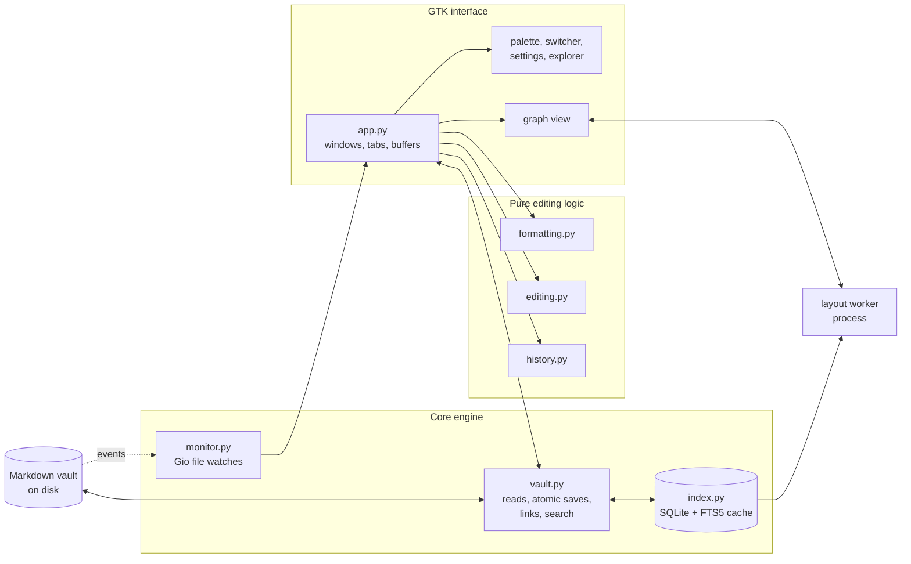

<a id="top"></a>

<div align="center">

```text
╭────────────────────────────────────────────────────────────────────────────────────────╮
│ (o)                                                                                (o) │
│                                                                                        │
│    ██╗     ██╗██████╗ ██████╗ ███████╗  ██╗   ██╗ █████╗ ██╗   ██╗██╗     ████████╗    │
│    ██║     ██║██╔══██╗██╔══██╗██╔════╝  ██║   ██║██╔══██╗██║   ██║██║     ╚══██╔══╝    │
│    ██║     ██║██████╔╝██████╔╝█████╗    ██║   ██║███████║██║   ██║██║        ██║       │
│    ██║     ██║██╔══██╗██╔══██╗██╔══╝    ╚██╗ ██╔╝██╔══██║██║   ██║██║        ██║       │
│    ███████╗██║██████╔╝██║  ██║███████╗   ╚████╔╝ ██║  ██║╚██████╔╝███████╗   ██║       │
│    ╚══════╝╚═╝╚═════╝ ╚═╝  ╚═╝╚══════╝    ╚═══╝  ╚═╝  ╚═╝ ╚═════╝ ╚══════╝   ╚═╝       │
│                                                                                        │
├────────────────────────────────────────────────────────────────────────────────────────┤
│         local markdown vaults   ::   native linux   ::   plain files, forever          │
│ (o)                                                                                (o) │
╰────────────────────────────────────────────────────────────────────────────────────────╯
```

**A free, native Linux editor for local Markdown vaults.**<br>
Your notes stay ordinary `.md` files in ordinary folders. No accounts, no lock-in, no proprietary formats.

<br>

[](LICENSE)
[](https://www.python.org/)
[](https://www.gtk.org/)
[](#installation)
[](#installation)
[](#project-status)

[](https://github.com/nickpio/libre-vault/commits/master)
[](https://github.com/nickpio/libre-vault/stargazers)
[](https://github.com/nickpio/libre-vault/issues)
[](#plain-files-in-place)
[](#data-and-storage)
[](docs/compatibility.md)

<br>

[**Features**](#features) &nbsp;&middot;&nbsp;
[**Install**](#installation) &nbsp;&middot;&nbsp;
[**Usage**](#usage) &nbsp;&middot;&nbsp;
[**Shortcuts**](#keyboard-shortcuts) &nbsp;&middot;&nbsp;
[**Graph**](#graph-view) &nbsp;&middot;&nbsp;
[**Architecture**](#architecture) &nbsp;&middot;&nbsp;
[**Roadmap**](#roadmap) &nbsp;&middot;&nbsp;
[**Development**](#development) &nbsp;&middot;&nbsp;
[**Testing**](#testing) &nbsp;&middot;&nbsp;
[**License**](#license)

</div>

<br>

> [!IMPORTANT]
> **Libre Vault is a working prototype.** It is a foundation for an Obsidian-compatible application, not yet a near-identical replacement. Start with the bundled example vault or a *copy* of a small vault. See [Project status](#project-status) and [Known limits](#known-limits).

<br>

## Overview

Libre Vault opens a folder of Markdown files and gives you a fast, keyboard-driven, native GTK workspace on top of it: live-preview editing, wikilinks and backlinks, filtered search, a force-directed graph, attachments, embeds, and crash recovery. Everything it knows about your vault is derived from the files themselves and can be thrown away and rebuilt at any time.

<table>
<tr>
<td align="center" width="25%"><b>Plain files</b><br><sub>Notes remain <code>.md</code>; <code>.obsidian</code> is never touched</sub></td>
<td align="center" width="25%"><b>Native</b><br><sub>Python + GTK 3, no browser engine</sub></td>
<td align="center" width="25%"><b>Safe writes</b><br><sub>Atomic replace, revision checks, recovery drafts</sub></td>
<td align="center" width="25%"><b>MIT licensed</b><br><sub>Independently written, no upstream code or assets</sub></td>
</tr>
</table>

<br>

## Features

- Edit Markdown in Live preview, Source, or Reading mode.
- Follow wikilinks and backlinks, with link completion and updates when notes move or change names.
- Edit properties and tags, and search by path, filename, content, tag, alias, or property.
- Explore connections in global and local graphs.
- Import attachments and preview images, PDFs, embedded notes, tables, callouts, and math.
- Navigate with a command palette, quick switcher, and keyboard shortcuts.
- Restore tabs, split panes, and cursor positions for each vault.
- Autosave with conflict checks and recovery drafts.
- Choose Dark, Light, or Lights Out themes and adjust fonts and layout.

<p align="right"><a href="#top">back to top</a></p>

## Installation

Build a **standalone executable** or an **AppImage** from a git checkout. Prebuilt AppImage releases are not published yet. To work on the application, see [Development](#development) for running directly from a checkout.

<table>
<tr>
<td width="50%" valign="top">

<h3>AppImage</h3>


**Main distribution method.** One self-contained file with Python, GTK, and every dependency bundled. Download, mark it executable, and run it. No root access and no system packages.

</td>
<td width="50%" valign="top">

<h3>Build from source</h3>


**For packagers and contributors.** Build the same standalone executable, or the AppImage itself, from a git checkout using your own toolchain.

</td>
</tr>
</table>

### AppImage (coming soon)

Once releases are published, the AppImage will be on the [**Releases**](https://github.com/nickpio/libre-vault/releases) page. Running it will follow the usual AppImage pattern:

```sh
chmod +x LibreVault-x86_64.AppImage
./LibreVault-x86_64.AppImage                 # welcome screen, or the last vault
./LibreVault-x86_64.AppImage /path/to/vault  # open a vault directly
```

The AppImage will keep the same startup behavior and storage locations as running from source. The bundle stays read-only: settings, workspaces, recovery drafts, and the index go to the usual XDG directories, and you never have to pass a vault path.

> [!NOTE]
> No official AppImage has been published yet. You can build your own using the instructions below.

### Build from source

On Linux, install the [runtime dependencies](#install-dependencies), Python's `venv` and `pip` tools, and `binutils` from your distribution. Include the PyGObject Cairo bridge, provided by `python3-gi-cairo` on Debian/Ubuntu or `python-cairo` on Arch. Debian/Ubuntu also need `python3-venv` for the environment below.

From the checkout root, create a build environment that can access your distribution's GTK bindings:

```sh
python3 -m venv --system-site-packages .venv-build
.venv-build/bin/python -m pip install -r requirements-build.txt
PYTHON=.venv-build/bin/python ./build.sh
```

The build produces `dist/libre-vault`, a single executable containing Python, GTK, the Python dependencies, and application resources. Poppler PDF previews are bundled when Poppler's introspection bindings are installed at build time. Rebuilding replaces the executable and requires no root access.

```sh
./dist/libre-vault                 # welcome screen, or the last vault
./dist/libre-vault /path/to/vault  # open a vault directly
./dist/libre-vault --help
```

You can move the executable outside the checkout. It uses the same XDG storage locations as `run.sh`. PyInstaller extracts the bundle to a temporary directory on startup, so that directory must allow executable files.

To also build an AppImage, install [appimagetool](https://github.com/AppImage/appimagetool) and pass its executable path:

```sh
PYTHON=.venv-build/bin/python ./build.sh --appimage --appimagetool /path/to/appimagetool
```

If `appimagetool` is on `PATH`, omit `--appimagetool`. The output is `dist/LibreVault-<architecture>.AppImage`. AppImage runtimes may need FUSE; supported runtimes also offer `--appimage-extract-and-run` on systems without it. The build does not download packaging tools automatically.

Build on the oldest Linux distribution you intend to support, using the target CPU architecture. These builds retain the build system's glibc and native-library compatibility requirements; wrapping the executable in an AppImage does not remove them. Cross-distribution validation, reproducible builds, and a complete dependency license inventory remain release work. Dependencies retain their own licenses.

Verify the actual executable with an isolated GUI smoke test:

```sh
./check.sh --script scripts/check_build.py
# Or verify a built AppImage:
./check.sh --script scripts/check_build.py dist/LibreVault-x86_64.AppImage
```

This copies the artifact outside the checkout, clears `PYTHONPATH`, and checks GTK startup, editing and saving, YAML aliases, Cairo, math rendering, image loading, and a spawned graph worker. It follows the background-display rules in [Testing](#testing).

<p align="right"><a href="#top">back to top</a></p>

## Usage

### Opening and closing vaults

The first launch shows a welcome screen with **Open vault**. Press <kbd>Ctrl</kbd>+<kbd>O</kbd> to choose a vault or an empty folder. Later launches reopen the last vault automatically; if that folder is unavailable, the welcome screen stays put. Settings and the command palette work before any vault is open. An explicit vault argument always takes precedence over the remembered one.

Use **Close vault** from the explorer's context menu or the command palette to return to the welcome screen. Unsaved notes offer **Save**, **Discard**, and **Cancel**. Closing a vault clears the startup choice, so the next launch stays on welcome until you open another.

### At a glance

| You want to | Do this |
| --- | --- |
| Create a note | <kbd>Ctrl</kbd>+<kbd>N</kbd>, or right-click the explorer |
| Jump to any note | <kbd>Ctrl</kbd>+<kbd>Shift</kbd>+<kbd>O</kbd> and type a path or alias |
| Run any command | <kbd>Alt</kbd>+<kbd>P</kbd> |
| Insert a link | Type `[[` for suggestions, or <kbd>Ctrl</kbd>+<kbd>K</kbd> |
| Follow a link | <kbd>Ctrl</kbd>+click it, or use **Outgoing links** / **Backlinks** |
| Compare two notes | <kbd>Ctrl</kbd>+<kbd>Shift</kbd>+<kbd>S</kbd> to split, then pick another tab |
| See the whole vault | <kbd>Ctrl</kbd>+<kbd>Alt</kbd>+<kbd>G</kbd> |
| Learn every shortcut | Command palette, then **Open keybind cheatsheet** |

<details>
<summary><b>File explorer</b></summary>
<br>

Right-click the explorer for **New note**, **New subfolder**, and **Open vault**. Right-clicking a folder creates inside it; right-clicking a note uses its parent folder; right-clicking empty space creates at the vault root. Empty folders appear immediately. The menu is also available with <kbd>Shift</kbd>+<kbd>F10</kbd> or the Menu key while the explorer has focus.

The same menu offers **Rename**, **Move**, and **Move to trash** for notes and folders. Rename and move update resolved incoming links and relative links inside moved notes, including local attachments. Unsaved editors offer Save, Discard, and Cancel before files change. Trashed items go to the vault's hidden `.trash` folder and can be restored with your file manager.

Notes are grouped beneath their folders with indentation per level. Click a folder to expand or collapse it. With the explorer focused, <kbd>Right</kbd> expands or enters a folder and <kbd>Left</kbd> collapses it or selects its parent. Opening a note reveals any collapsed parent folders.

</details>

<details>
<summary><b>Live preview and formatting</b></summary>
<br>

Headings, emphasis, code, quotes, and link labels format in the writing area as you type. The line containing the cursor reveals its Markdown syntax; move away and the markers hide again. Frontmatter is concealed until the cursor or selection enters it, and <kbd>Ctrl</kbd>+<kbd>Home</kbd> reveals it. Copy, cut, and save always retain the original Markdown.

Live preview also previews standalone local Markdown images; move the cursor into the image Markdown to edit its source. Images embedded within text and wiki-style embeds still require Reading mode. Remote images are never fetched.

The outline indents nested headings, wraps long titles, and highlights the section containing the cursor. Click a heading to jump to it.

</details>

<details>
<summary><b>Lists and tasks</b></summary>
<br>

Lists display bullets or numbers with nested indentation. Task lists display checkboxes: click one, or focus it and press <kbd>Space</kbd>, to toggle it. Completed tasks are crossed out. Toggling updates the Markdown and schedules an autosave. Select a marker's source range to reveal it for direct editing.

<kbd>Enter</kbd> continues a list with the same indentation and bullet style. Numbered lists advance, and new tasks start unchecked. On an empty item, <kbd>Enter</kbd> exits the list and leaves a blank line. <kbd>Shift</kbd>+<kbd>Enter</kbd> keeps the standard line break.

</details>

<details>
<summary><b>Find, replace, and undo history</b></summary>
<br>

Find searches the complete Markdown source, including concealed syntax and frontmatter. Searches are literal and case-insensitive by default; toggle **Aa** to match case. <kbd>Enter</kbd> advances, <kbd>Shift</kbd>+<kbd>Enter</kbd> goes back, and <kbd>Escape</kbd> closes the bar. **Replace All** applies to the active note and undoes as one action. The editor's context menu exposes the same commands.

Each tab keeps up to **500 undo actions** within an estimated **8 MiB** budget. The oldest actions are discarded as needed; a single edit larger than the budget clears history and cannot itself be undone. Adjacent typing and deletion are grouped; task toggles, list continuation, formatting, and replacements are individual actions. Undo restores the cursor and selection. Saving preserves history, and returning to the saved text clears the unsaved indicator. Reloading a clean note after an external change clears that tab's history.

</details>

<details>
<summary><b>Search syntax</b></summary>
<br>

Search shows saved-note snippets with highlighted matches. Plain words match paths and contents case-insensitively.

| Syntax | Matches |
| --- | --- |
| `word` | Paths and contents containing `word` |
| `"exact phrase"` | The quoted phrase |
| `path:Projects` / `file:plan` | Note path or file name |
| `content:deadline` | Note contents only |
| `tag:work` | Frontmatter or inline tag |
| `alias:roadmap` | Frontmatter alias |
| `property:status=done` | A property with a value |
| `[status]` | Notes that have the property at all |
| `-term` | Excludes anything matching `term` |

For example, `tag:work property:status=done -path:Archive` finds completed work outside `Archive`. Unsaved edits are not included in search or backlink indexing; outgoing links use the active editor contents.

</details>

<details>
<summary><b>Attachments and embeds</b></summary>
<br>

Use the attachment button to copy a file into the vault's `attachments` folder and insert its link. Pasting a screenshot or dropping local files into the editor uses the same storage. Identical files with the same extension are reused; different files get a new name when necessary. Undo removes the inserted Markdown but keeps the copied file. The root `attachments` folder is hidden from the file tree but remains accessible in your file manager.

Reading mode displays local images and `![[note]]` embeds. PDFs embedded with `![[file.pdf]]` get page controls when Poppler is installed, with an **Open** button that falls back to the system viewer. Each render is limited to 32 embedded files and 4 MiB of embedded note source; open files separately when a preview reaches the limit.

</details>

<details>
<summary><b>Properties, tags, and aliases</b></summary>
<br>

The details panel shows tags, aliases, and properties. **Edit properties** edits YAML frontmatter as one undoable action. Tags come from frontmatter lists or inline `#tags`, including nested tags. Aliases participate in link resolution and the quick switcher; ambiguous names still prompt for a choice.

</details>

<details>
<summary><b>Tabs, splits, and workspace restore</b></summary>
<br>

Opening a vault restores its tabs, cursor and scroll positions, collapsed folders, and split editor. A split shares the original note's source buffer and undo history, so you can keep one note in the split while selecting another tab to compare them.

</details>

<details>
<summary><b>Command palette and cheatsheet</b></summary>
<br>

<kbd>Alt</kbd>+<kbd>P</kbd> opens the compact command palette near the top of the workspace. Type to filter, <kbd>Enter</kbd> to run, and <kbd>Escape</kbd> or click outside to return to your previous control.

**Open keybind cheatsheet** shows the full keyboard reference grouped by application, editor, file explorer, tabs, and dialogs. It opens with search focused: type a key combination, action, or section name. <kbd>Up</kbd>/<kbd>Down</kbd> browse results while typing, <kbd>Enter</kbd> focuses the list, <kbd>Left</kbd>/<kbd>Right</kbd> jump between sections, <kbd>Home</kbd>/<kbd>End</kbd> reach the first or last result, and <kbd>Ctrl</kbd>+<kbd>F</kbd> returns to search.

</details>

<details>
<summary><b>Settings and appearance</b></summary>
<br>

The gear icon at the bottom-left opens **Settings**, with a category sidebar and live preferences. It stays reachable even when both sidebars are hidden.

| Category | Options |
| --- | --- |
| Appearance | Dark, Light, or Lights Out theme; interface font size; text font family; text size |
| Editor | Readable line length, writing column width, line wrapping, list continuation on Enter |

Changes apply immediately to open notes and future tabs. **Restore defaults** resets everything. Both sidebars open and close with a short slide transition that preserves splitter widths and respects GTK's system animation preference.

</details>

<p align="right"><a href="#top">back to top</a></p>

## Keyboard shortcuts

<table>
<tr>
<td valign="top" width="50%">

#### Application

| Shortcut | Action |
| --- | --- |
| <kbd>Alt</kbd>+<kbd>P</kbd> | Command palette |
| <kbd>Ctrl</kbd>+<kbd>O</kbd> | Open a vault |
| <kbd>Ctrl</kbd>+<kbd>N</kbd> | Create a note |
| <kbd>Ctrl</kbd>+<kbd>S</kbd> | Save the active note |
| <kbd>Ctrl</kbd>+<kbd>W</kbd> | Close the active tab |
| <kbd>Ctrl</kbd>+<kbd>Shift</kbd>+<kbd>D</kbd> | Toggle note details panel |
| <kbd>Ctrl</kbd>+<kbd>Shift</kbd>+<kbd>E</kbd> | Toggle file tree |
| <kbd>Ctrl</kbd>+<kbd>Shift</kbd>+<kbd>O</kbd> | Fuzzy note switcher |
| <kbd>Alt</kbd>+<kbd>Left</kbd> / <kbd>Right</kbd> | Navigate back / forward |
| <kbd>Ctrl</kbd>+<kbd>Shift</kbd>+<kbd>S</kbd> | Open or close a split editor |
| <kbd>Ctrl</kbd>+<kbd>Alt</kbd>+<kbd>G</kbd> | Graph view |

</td>
<td valign="top" width="50%">

#### Editor

| Shortcut | Action |
| --- | --- |
| <kbd>Ctrl</kbd>+<kbd>Z</kbd> | Undo |
| <kbd>Ctrl</kbd>+<kbd>Shift</kbd>+<kbd>Z</kbd> | Redo |
| <kbd>Ctrl</kbd>+<kbd>B</kbd> | Toggle bold |
| <kbd>Ctrl</kbd>+<kbd>I</kbd> | Toggle italics |
| <kbd>Ctrl</kbd>+<kbd>K</kbd> | Insert a link to a URL or note |
| <kbd>Ctrl</kbd>+<kbd>F</kbd> | Find in note |
| <kbd>Ctrl</kbd>+<kbd>H</kbd> | Find and replace |
| <kbd>F3</kbd> or <kbd>Ctrl</kbd>+<kbd>G</kbd> | Next match |
| <kbd>Shift</kbd>+<kbd>F3</kbd> or <kbd>Ctrl</kbd>+<kbd>Shift</kbd>+<kbd>G</kbd> | Previous match |
| <kbd>Ctrl</kbd>+<kbd>Home</kbd> | Reveal frontmatter |

</td>
</tr>
</table>

Bold and italic toggle markers around a selection, or insert a paired set when nothing is selected.

<p align="right"><a href="#top">back to top</a></p>

## Graph view

Open **Graph view** from the header, the command palette, or <kbd>Ctrl</kbd>+<kbd>Alt</kbd>+<kbd>G</kbd>. Notes appear as nodes sized by their number of connections.

| Interaction | Result |
| --- | --- |
| Hover a node | Highlight its neighbors and show the full path |
| Click a node | Open the note |
| Drag background / node | Pan / place the node (freezes layout) |
| Scroll | Zoom around the pointer |
| **Fit** or <kbd>F</kbd> | Frame the whole graph |
| Arrow keys, <kbd>Enter</kbd> | Select and open notes |
| <kbd>+</kbd> / <kbd>-</kbd> | Zoom |
| <kbd>Escape</kbd> | Close a floating graph window |

<details>
<summary><b>Graph tabs, splits, and local graphs</b></summary>
<br>

**Open graph in tab** (command palette) or **Open as tab** (floating window) docks the graph in the workspace. With the graph tab selected, press <kbd>Ctrl</kbd>+<kbd>Shift</kbd>+<kbd>S</kbd> or use the split-view button, then select a note in the main tabs: the graph stays in the split and clicking a node opens its note beside it. You can also split a note first and keep the graph in the main tab. Graph tabs, filters, local depth, and split placement are restored when the vault reopens. Close a graph tab with its close button or <kbd>Ctrl</kbd>+<kbd>W</kbd>.

**Open local graph in tab** and **Local graph** show the active note's neighborhood at a depth of one to five links. The local root stays fixed to the note that was active when the graph opened. Search filters paths and aliases by words; turn off **Orphans** to hide unconnected notes.

</details>

<details>
<summary><b>What the graph includes, and how it stays fast</b></summary>
<br>

The graph uses saved, unambiguous note links, including note embeds. Duplicate links are merged; self-links, unresolved targets, attachments, and external URLs are omitted. Saving or refreshing the vault updates an open graph, and **Refresh** rebuilds and rearranges it manually.

A separate process reads only indexed paths, aliases, and links and computes the layout. Crowded spatial cells use aggregate repulsion to avoid all-pairs calculations. Layout has an eight-second work window and a 160-step limit before releasing the worker. The canvas draws at most 150 labels plus the focused note, skips offscreen drawing, and redraws only for layout or interaction changes. Hidden graph tabs stop their workers and defer updates until visible.

Tag nodes, custom color groups, and Obsidian's full graph filter syntax are not implemented.

</details>

<p align="right"><a href="#top">back to top</a></p>

## Data and storage

Libre Vault never writes its own state into your vault. Everything below lives in standard XDG locations and can be deleted safely while the app is closed.

| What | Where | Notes |
| --- | --- | --- |
| Preferences | `$XDG_CONFIG_HOME/libre-vault/settings.json` | Falls back to `~/.config/libre-vault/` |
| Workspace layouts | `.../libre-vault/workspaces.json` | Tabs, cursors, splits, graph tabs per vault |
| Startup vault | `.../libre-vault/session.json` | Which vault to reopen |
| Recovery drafts | `$XDG_STATE_HOME/libre-vault/recovery` | Falls back to `~/.local/state/`; contains note text |
| Search and link index | `$XDG_CACHE_HOME/libre-vault` | Falls back to `~/.cache/`; SQLite, mode `0600`, fully rebuildable |
| Trashed notes | `<vault>/.trash` | Restore with your file manager |
| Imported attachments | `<vault>/attachments` | Hidden from the tree, visible on disk |

<details>
<summary><b>Saving, autosave, and recovery</b></summary>
<br>

Edits autosave after two seconds of inactivity; <kbd>Ctrl</kbd>+<kbd>S</kbd> saves immediately. While a note has unsaved edits, a private recovery draft is kept. After an interrupted session, reopening the vault offers to recover or discard each draft. A recovered draft keeps its original file revision, so an external edit or deletion prevents autosave from overwriting it.

External changes are detected through filesystem notifications. Clean tabs reload; dirty tabs keep local edits and conflicting saves stop. Closing a dirty tab or window offers Save, Discard, and Cancel.

> [!CAUTION]
> Recovery drafts contain note text. Protect your user account and backups accordingly.

</details>

<details>
<summary><b>Memory and the disk index</b></summary>
<br>

A rebuildable SQLite cache stores note content, metadata, and links outside the vault. Unopened notes do not keep their full text in memory, and loaded saved-note text uses a 4 MiB cache. FTS5 trigrams narrow substring searches of three or more characters before exact matching. Delete the cache with the app closed to rebuild it on the next launch.

</details>

<p align="right"><a href="#top">back to top</a></p>

## Architecture



The UI talks to the vault engine directly:

```python
vault = Vault('/path/to/vault')
note = vault.read('Projects/Plan.md')
saved = vault.save(note, '# Revised plan\n')   # raises Conflict if the file changed on disk
```

Each `Note` records its relative path, text, SHA-256 revision, and BOM flag. `Vault.resolve(source, target)` returns every matching path: empty means unresolved, several means ambiguous, and the UI asks rather than guessing.

Read the full design notes in [**docs/architecture.md**](docs/architecture.md).

<p align="right"><a href="#top">back to top</a></p>

## Project status

<a id="roadmap"></a>

### Roadmap

- [x] **Runnable storage prototype.** Open a vault, edit, navigate links, search, verify changes on disk.
- [ ] **Compatibility evidence.** Shared fixtures run against a pinned Obsidian version, with machine-readable diffs.
- [ ] **Daily editing.** Final editor choice, structured properties, saved-version history, incremental indexing.
- [ ] **Core feature parity.** Canvas, templates, daily notes, full search behavior, fixture-based acceptance checks.
- [ ] **Linux release.** AppImage as the main download, a from-source executable build, license inventory, reproducible builds, large-vault budgets.

### Feature coverage

| Area | Status |
| --- | --- |
| Open existing vaults in place |  |
| Live preview, source, and reading modes |  |
| Undo/redo, find/replace, formatting commands |  |
| Wikilinks, backlinks, aliases, rename with link updates |  |
| Search, quick switcher, command palette |  |
| Tabs, splits, and workspace restore |  |
| Atomic writes, autosave, crash recovery drafts |  |
| Graph and local graph |  |
| Callouts, tables, footnotes, math |  mathtext subset, no diagrams |
| Attachments and transclusion |  whole-note embeds only |
| Heading and block links |  approximate anchors |
| Outline, templates, daily notes, bookmarks |  outline only |
| Saved-version history, unlinked mentions |  |
| Canvas (JSON Canvas) |  |
| From-source executable and AppImage builds |  local builds; prebuilt releases pending |
| Plugins, mobile, hosted sync |  |

The full matrix and acceptance gates live in [**docs/compatibility.md**](docs/compatibility.md).

### Known limits

<details>
<summary><b>Read before trusting it with a real vault</b></summary>
<br>

- **Durability.** Recovery keeps the latest unsaved draft, not a history of saved versions. Save checks reduce accidental overwrites but cannot lock out unrelated programs, and a narrow race remains between the final comparison and atomic replacement. Hard links, extended attributes, file ownership, and arbitrary mixed line endings are not preserved as a compatibility contract.
- **Rendering.** Live formatting handles a subset of CommonMark; richer media and block rendering use Reading mode. Math uses Matplotlib's mathtext rather than a full LaTeX engine, and unsupported expressions display their source with a message. Note embeds show whole notes; section and block transclusion are incomplete.
- **Links and search.** Heading and block navigation uses a text match rather than Obsidian's full anchor rules. Link resolution is case-sensitive and reports ambiguous basenames and aliases. Search supports the documented filters, not every Obsidian query operator.
- **Files.** Symbolic links, dotfiles, and hidden folders are excluded from browsing. Non-UTF-8 files are left unchanged and report an error when opened.
- **Scale.** Filesystem notifications update changed notes and subtrees without periodic full-vault reads, but initial indexing, explicit rescans, and multi-file organization still scan the vault. Large-vault latency has not been optimized.
- **Moves.** Multi-file moves use revision checks and roll back after ordinary failures, but are not a crash-atomic transaction. Interrupted moves keep original rewritten-note bytes and a manifest under `.trash/.librevault-moves` for manual recovery.
- **Not yet built.** Canvas, unlinked mentions, saved-version history, full search syntax, plugins, sync, mobile support, and published AppImage releases.

</details>

<p align="right"><a href="#top">back to top</a></p>

## Development

Run directly from a checkout while developing Libre Vault. Restart after editing Python or CSS files to see your changes; no executable rebuild is needed.

### Runtime requirements

| Dependency | Version | Purpose |
| --- | --- | --- |
| Python | 3.10+ | Runtime |
| GTK 3 + PyGObject | PyGObject 3.42+ | Native user interface |
| markdown-it-py | 3.x - 4.x | Markdown parsing |
| PyYAML | 6.x | Frontmatter and properties |
| Matplotlib | 3.6+ | Math rendering (mathtext) |
| Poppler GLib | optional | Inline PDF page previews |

### Install dependencies

<details open>
<summary><b>Debian / Ubuntu</b></summary>

```sh
sudo apt install python3-gi gir1.2-gtk-3.0 python3-markdown-it python3-yaml python3-matplotlib gir1.2-poppler-0.18
```

</details>

<details>
<summary><b>Arch Linux</b></summary>

```sh
sudo pacman -S python-gobject gtk3 python-markdown-it-py python-yaml python-matplotlib poppler-glib
```

</details>

<details>
<summary><b>Fedora</b></summary>

```sh
sudo dnf install python3-gobject gtk3 python3-markdown-it-py python3-pyyaml python3-matplotlib poppler-glib
```

</details>

<details>
<summary><b>pip (Python packages only)</b></summary>

GTK 3 itself and its GObject introspection data must still come from your distribution.

```sh
python3 -m pip install -r requirements.txt
```

</details>

### Run from source

```sh
git clone https://github.com/nickpio/libre-vault.git
cd libre-vault

./run.sh                  # open the welcome screen (or the last vault)
./run.sh example-vault    # open the bundled example vault
./run.sh /path/to/vault   # open any existing vault folder
```

> [!TIP]
> `run.sh` works from any directory and resolves relative vault paths from your current location. The equivalent Python entry point is `python3 -m librevault [vault]`.

<p align="right"><a href="#top">back to top</a></p>

## Testing

```sh
./check.sh                       # full test suite
./check.sh --smoke               # GUI smoke check
./check.sh --foreground          # interactive debugging on your desktop
./check.sh --script probe.py     # run a standalone GUI probe in the background
```

> [!NOTE]
> GUI checks never steal your desktop. On **Hyprland**, windows, dialogs, and child-process probes open silently on a temporary `librevault-tests` workspace without taking focus. On other desktops, install **Xvfb** to use a private display. If neither is available, the runner refuses to open GUI windows unless you pass `--foreground`; without any display, GUI tests are skipped.

Test runs use temporary configuration and recovery directories, so your real settings and last-opened vault are untouched. The GUI test opens a temporary copy of the example vault, follows a link, edits, exercises undo/redo and find/replace, saves, reads the file back, checks external reload and conflict handling, and runs a search. The bundled example vault is never modified.

## Contributing

Issues and pull requests are welcome. Before opening a pull request:

1. Run `./check.sh` and make sure it passes.
2. Keep vault files byte-for-byte safe: new features must never rewrite syntax they do not understand.
3. Update [docs/architecture.md](docs/architecture.md) or [docs/compatibility.md](docs/compatibility.md) when behavior or scope changes.

## License

Released under the [**MIT License**](LICENSE). Runtime dependencies retain their own licenses.

Libre Vault contains independently written code and no Obsidian implementation code or assets. Obsidian is a separate product, and this project is not affiliated with it.

<br>

<div align="center">

```text
(o) ─────────────── your notes, your files, your machine ─────────────── (o)
```

<sub>[back to top](#top)</sub>

</div>
