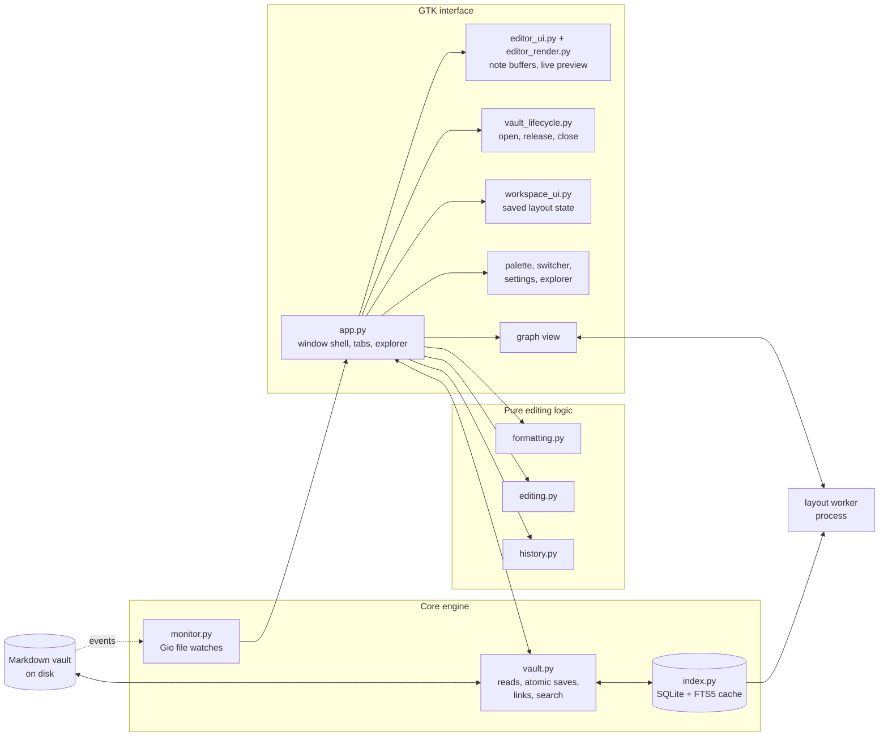

# Architecture decisions

The initial target is Linux desktop, existing Markdown vaults, and eventual parity with Obsidian's core features. Running existing Obsidian plugins is outside the first version.

## Components



## Startup and distribution

The vault argument is optional. First launch shows the welcome screen. Later launches reopen the last successfully opened vault, recorded in settings-adjacent `session.json`. An explicit folder argument takes precedence. Missing or unavailable remembered folders leave the welcome screen available without a modal error. Choosing a folder switches the same window into its workspace. Close vault confirms unsaved notes, persists the workspace, cancels its watchers and callbacks, disposes its editors, and clears the remembered startup vault. The GTK application handles activation separately from file-open events, so each launch receives its own optional folder argument even when another instance is running.

`python3 -m librevault` is the application entry point. `run.sh` adds the source directory to Python's import path without changing the caller's working directory. Assets resolve relative to the package and preferences use the user's XDG configuration directory.

`build.sh` runs `scripts/build.py` with the selected `PYTHON` interpreter. The PyInstaller specification in `packaging/` bundles a single executable, including `style.css`, GTK resources, optional Poppler bindings, and Matplotlib's Agg backend. The frozen entry point calls `multiprocessing.freeze_support()` before importing GTK so graph workers dispatched with `spawn` run as workers. Optional AppImage packaging wraps the executable in an AppDir without changing the caller's working directory or the XDG storage contracts. The bundle remains read-only and a vault path is never required. `scripts/check_build.py` verifies a copied artifact outside the checkout through its bundled smoke test.

## Caller contract

The GTK-free vault engine supports synchronous callers:

```python
vault = Vault('/path/to/vault')
note = vault.read('Projects/Plan.md')
saved = vault.save(note, '# Revised plan\n')
```

`Note` records its relative path, text, SHA-256 revision, and UTF-8 byte-order mark. A save compares the revision against the current disk file. A mismatch raises `Conflict` and leaves the editor's text available.

`Vault.resolve(source, target)` returns a list of matching paths. An empty list means unresolved. Multiple paths mean ambiguous. The UI asks the user to choose a candidate rather than silently picking one.

## Ownership

| Module | Owns |
| --- | --- |
| `librevault/vault.py` | Path validation, UTF-8 reads, revision checks, atomic replacement, link parsing, resolution, search, and backlinks |
| `librevault/monitor.py` | Recursive Gio directory watches, coalesced filesystem events, and watch cleanup |
| `librevault/index.py` | Disposable SQLite content, metadata, link and substring indexes, plus a byte-bounded text cache |
| `librevault/worker.py` | Serial background vault jobs, per-job SQLite connections, cancellation, progress, snapshots, and rejection of superseded callbacks |
| `librevault/app.py` | Window shell, tabs, file tree, details panel, commands, and event-driven refresh |
| `librevault/editor_ui.py` | Note editor ownership: buffer, history, autosave, recovery draft, folding, multicursor, vim, and editing commands |
| `librevault/editor_render.py` | Live-preview rendering: syntax spans, widgets for media/math/tables/callouts/embeds, list controls, and widget positioning |
| `librevault/vault_lifecycle.py` | Opening, releasing, and closing a vault, its stores, recovery drafts, watchers, and dirty-note confirmation |
| `librevault/workspace_ui.py` | Capturing, persisting, restoring, naming, and deleting workspace layouts and their navigation remapping |
| `librevault/formatting.py` | Pure source-offset formatting spans, syntax ranges, and list/task structure derived from Markdown tokens |
| `librevault/editing.py` | Pure source edits for list continuation, emphasis toggles, link construction, and literal match offsets |
| `librevault/history.py` | Per-buffer grouped source deltas, typing coalescence, selection restoration, and bounded undo/redo stacks |
| `librevault/findbar.py` | Active-note search highlights, navigation, and grouped replacements on original Markdown |
| `librevault/filetree.py` | Pure folder-first traversal of visible note paths and folders, respecting collapsed folders |
| `librevault/commands.py` | Searchable command palette overlay and grouped keybind cheatsheet dialog |
| `librevault/settings.py` | Category-based appearance/editor settings dialog, live controls, and save-error feedback |
| `librevault/preferences.py` | Preference defaults, configuration validation, and atomic storage outside the vault |
| `librevault/appearance.py` | Shared dark/light theme colors and generated typography styles |
| `librevault/panels.py` | Native sidebar reveal transitions synchronized with splitters and saved panel widths |
| `librevault/organization.py` | Move/trash validation, revision checks, link target rewrites, and rollback |
| `librevault/metadata.py` | Safe YAML properties, inline tags, aliases, search filters, and snippet offsets |
| `librevault/navigation.py` | Fuzzy path/alias ranking and bounded back/forward locations |
| `librevault/navigation_ui.py` | Quick switcher, wikilink completion, and Ctrl-click link navigation |
| `librevault/splitview.py` | Secondary shared-buffer editor with mirrored list and task controls |
| `librevault/workspace.py` | Atomic per-vault tab, cursor, scroll, folder, and split state outside vaults |
| `librevault/attachments.py` | Collision-safe attachment copies and confined local asset resolution |
| `librevault/reading.py` | Native Markdown reading widgets, callouts, footnotes, whole-note/section/block transclusions, media embeds, code copy buttons, and optional Poppler PDF pages |
| `librevault/anchors.py` | Obsidian-style `#Heading`, `#Parent#Child`, and `#^block-id` resolution, section/block extraction, and completion listings |
| `librevault/syntax.py` | Language alias normalization and token-level syntax highlighting spans for fenced code blocks |
| `librevault/tables.py` | Pure Markdown table parsing, cell navigation, column padding, alignment, sorting, and row/column mutations |
| `librevault/folding.py` | Heading, nested list, fenced code, and frontmatter fold region calculation and per-pane fold state |
| `librevault/slash.py` | Filterable `/` command catalog and single-action snippet insertion |
| `librevault/multicursor.py` | Word/selection occurrence matching and simultaneous multi-range buffer edits |
| `librevault/vim.py` | Optional modal Vim state machine (`NORMAL`, `INSERT`, `VISUAL`) with motions, operators, and text objects |
| `librevault/mermaid.py` | Cairo and Pango rendering for flowcharts, sequence, state, and class diagrams, with a source card for other Mermaid syntax |
| `librevault/math_render.py` | LaTeX macro expansion and multi-line environment layout for Matplotlib mathtext |
| `librevault/shortcuts.py` | Application shortcut registry shared by key handling and the cheatsheet, plus contextual GTK bindings |
| `librevault/canvas.py` | Pure JSON Canvas 1.0 parsing, serialization, node/edge operations, and atomic file saves |
| `librevault/canvas_ui.py` | Interactive GTK JSON Canvas tab with pan/zoom, card editing, edge connections, and note navigation |
| `librevault/templates.py` | Template variable expansion, daily notes, unique timestamped notes, and random note selection |
| `librevault/bookmarks.py` | Per-vault bookmark storage, remapping, bookmark manager, and named workspace manager dialogs |
| `librevault/mentions.py` | Plain-text unlinked mention detection and one-click wikilink conversion |
| `librevault/bases.py` | Property database querying, sorting, and YAML property cell updates across vault notes |
| `librevault/bases_ui.py` | Filterable and sortable GTK table view over note frontmatter properties |
| `librevault/slides.py` | Slide deck splitting on horizontal rules and fullscreen presentation window |
| `librevault/converter.py` | Markdown link, wikilink, and Roam/Logseq syntax conversion utilities and dialog |
| `tests/test_editing.py` | Exact Markdown and cursor positions for list/task keyboard actions |
| `tests/test_formatting.py` | Source offsets, nesting, escapes, literal code, and incomplete Markdown |
| `tests/test_ofm_syntax.py` | Highlights (`==`), strikethrough (`~~`), comments (`%%`), and fenced-code syntax highlighting |
| `tests/test_transclusion_anchors.py` | Section/block transclusion, exact anchors, `#`/`#^` completion, image dimensions, and hover previews |
| `tests/test_diagrams_math_media.py` | Mermaid diagrams, expanded LaTeX math environments, callouts, footnotes, safe HTML, and media cards |
| `tests/test_live_preview_tables.py` | Live preview block widgets and interactive Markdown table operations |
| `tests/test_editor_ergonomics.py` | Code/heading folding, slash commands, multi-cursor editing, and Vim modal editing |
| `tests/test_vault.py` | Repeatable filesystem and parsing regression cases |
| `tests/smoke_gui.py` | The real GTK edit-to-save path and external-change behavior |

Disk files are authoritative. The index is disposable and rebuilt from files. Each open note owns its unsaved editor buffer and the revision it opened. Split views share that buffer and its edit history. The engine has no GTK dependency. The UI uses the same parser as the index.

Application preferences live in the user's XDG configuration directory, independently of vaults. Loading missing or malformed preferences uses defaults without writing files. Changes save through atomic replacement before applying to all open windows. CSS and Markdown text tags share the same theme colors. Appearance updates change widget styles and layout without rewriting note buffers or changing dirty state. A failed settings save retains the previous preferences and reports the error in the settings dialog.

A save writes a temporary file in the note's directory, flushes it, checks the source revision again, and atomically replaces the note. The temporary file is removed after a failure. This is optimistic conflict detection, not a filesystem transaction with other editors. Directory fsync, recovery versions, and a stronger concurrent-writer design remain release prerequisites.

## Live editing

Each `NotePane` owns one `Gtk.TextBuffer` containing the original Markdown. `markdown_layout(text)` returns style spans, syntax ranges, list items, fenced-code syntax tokens, math spans, callout headers, tables, embeds, and diagrams without changing the text. CommonMark block maps identify headings, literal code, and actual list items; inline rules retain source offsets before delimiter balancing resolves nested emphasis, highlights (`==`), strikethrough (`~~`), and Obsidian comments (`%%`). List items record nesting depth, displayed numbering, and the source offset of a task's state character. The GTK adapter applies text tags and conceals syntax outside the cursor's line and selected ranges. When the cursor and selection are outside a standalone image, note/subpath embed, display math block, Mermaid fence, Markdown table, or callout header, Live preview conceals the source lines and positions a rendered GTK widget above the block. Folded headings, nested lists, fenced code blocks, and YAML frontmatter also use the `hidden` tag so copy, cut, indexing, search, and save always include the full Markdown.

Bullets, numbers, fold gutter toggles (`▾` / `▸`), extra multi-cursor carets, and native `Gtk.CheckButton` controls are positioned in the text view's widget window beside the text. They are not buffer anchors, so they add no characters to the note. List margins keep wrapped lines aligned; scrolling and resizing reposition the controls. A task toggle replaces just its state character and follows the normal dirty-buffer/save path. Controls are rebuilt when source text changes. Stale controls cannot mutate unrelated source after a pending edit.

Edits and cursor movement schedule one idle formatting pass. Source spans are cached until the text changes. Applying styles does not change the dirty state. External reloads replace the same buffer and rerun formatting, retaining the existing revision checks.

The editor routes key presses through optional Vim modal editing (`librevault/vim.py`), the `/` slash-command popup (`librevault/slash.py`), `#` and `#^` wikilink completion, multi-cursor editing (`librevault/multicursor.py`), and interactive table cell navigation (`librevault/tables.py`) before falling back to `list_enter(text, cursor)` on unmodified Enter. This pure function parses the current source and returns one replacement range, or no edit when GTK should handle the key normally. Bullets preserve their style and indentation, ordered lists advance their displayed number, and new task markers are unchecked. Empty items exit with a blank separator to prevent subsequent prose from becoming a lazy list continuation. The adapter applies the edit as one user action and places the caret after the replacement. It does not use cached widget positions, so consecutive Enter presses work before formatting runs.

Each `NotePane` owns a `BufferHistory`. Insert/delete signals record character-offset source deltas and before/after selections. GTK user-action boundaries make compound edits atomic for undo; adjacent typing and deletion coalesce for up to one second, ending at whitespace boundaries or cursor movement. History holds at most 500 actions and an estimated 8 MiB of retained action data per buffer, and excludes text tags. Oldest actions are evicted first. A single compound edit that exceeds the budget establishes a new undo checkpoint, clearing prior history rather than retaining a partial action. Replay uses buffer edits without recording itself. Dirty state compares the current source with the saved note, so undo/redo can cross a save checkpoint without changing its disk revision. External reload suspends recording and clears history before adopting the new source.

The in-note find bar searches original source, including invisible characters. Literal matches use source offsets rather than offsets in rendered text. Replacements modify those ranges; Replace All walks matches backwards inside one user action. Search highlights use a separate text tag and never enter edit history. Editor shortcuts are scoped to the editor; find-field keyboard controls are routed before GTK entry defaults so Escape closes the bar and text-entry editing cannot format the note.

A separate rendered editing buffer would require translating every cursor offset, selection, and edit back into source Markdown. Keeping the source buffer avoids that mapping and preserves existing save and navigation contracts. Source mode removes concealed syntax, while Reading builds separate widgets from the same original text. Reading widgets never modify the source or enter undo history. Local images and PDF pages are scaled, note transclusion is bounded and detects cycles, and remote images are not fetched. Math uses Matplotlib mathtext after common macros and aligned, gathered, case, and matrix environments are expanded; unsupported expressions keep their source and show an error message. Mermaid fences draw flowcharts, sequence, state, and class diagrams in Reading and live preview, and other diagram syntax stays a styled source card. Reading also renders collapsible callouts, clickable footnotes, a small set of inline HTML tags, and local audio and video cards.

Split editors share a canonical note's `Gtk.TextBuffer`, so changes use the same revision, autosave, and undo history. Workspace state stores paths and positions, not draft text, in a settings-adjacent `workspaces.json`. Restoring a vault ignores missing notes and malformed positions. Last-vault startup state lives separately in `session.json`, so closing a vault preserves its workspace while returning future launches to welcome.

Organization resolves link targets against the old index before computing their new paths. The move also checks links that could be shadowed by a new local filename. Before rewriting links, it saves original bytes and a move manifest under `.trash/.librevault-moves`. Successful moves and complete rollbacks remove their backup. Interrupted moves or incomplete rollbacks leave it available for manual recovery. The UI confirms dirty buffers before changing files and updates open pane paths, recovery drafts, and navigation history afterward. Search and backlinks index saved files; property edits use the normal undoable source-edit path before autosave updates that index.

## Alternatives considered

A browser application with a local HTTP server would make HTML previews easier but add a server lifecycle and local network boundary. This prototype uses GTK and direct filesystem calls so the storage contract can be exercised in one process.

An Electron editor with CodeMirror is another candidate for the final editing experience. It offers a stronger foundation for Obsidian-like live preview, at the cost of a browser runtime and additional JavaScript dependencies. GTK was selected for the runnable Linux prototype; that choice remains provisional until a live-preview editing spike establishes whether it can meet the required experience. The independently tested vault behavior should remain the reference if the shell changes.

A database as the authoritative note store would require import and export behavior and risk diverging from ordinary vault files. SQLite stores only derived indexes; deleting the cache never deletes Markdown files.

## Risks that need evidence

- No tests have compared this implementation against a running Obsidian instance. Current fixtures test documented syntax and the prototype's stated behavior.
- Initial scans, filesystem reconciliation, search, backlinks, unlinked mentions, and tag counts run on a cancellable worker with its own SQLite connection. GTK applies snapshots and renders file lists in bounded pages and idle slices. [Latency budgets and reproducible large-vault measurements](performance.md) cover this work; single-note rendering and bulk organization still need separate latency work.
- Live editing now has cursor reveal, selection, clipboard, and save checks. Embedded widgets, large-document latency, and IME interactions still need evidence before committing to GTK as the final editor.
- Rename-with-link-updates spans multiple files. Revision checks and rollback handle ordinary failures; multi-file moves are not crash-atomic.
- External editors do not participate in the prototype's revision protocol. Save races need a tested preservation policy before recommending use on primary vaults.

## Filesystem monitoring

Each open vault owns Gio directory monitors for its visible, non-symlink directories and a parent watch for root replacement. Notifications are coalesced for 100 ms, then reconciled against current disk state. File changes read only the affected Markdown notes; directory changes scan that subtree and reinstall its watches. Both sides of moves are reconciled. Non-Markdown events also refresh reading dependencies, including attachments. Buffer changes independently queue an idle reading refresh so unsaved transclusions remain current.

An initial reconciliation after watch installation closes the scan/watch startup gap. Explicit `Window.refresh()` queues a full rescan; `Vault.refresh()` remains synchronous for engine callers, including organization operations. The window installs watches from the scanned folder snapshot, avoiding a second walk of every note on GTK. Switching vaults or destroying the window disconnects and cancels watches and pending callbacks. Watch-installation failures appear in the status bar; reopening the vault retries them. There is no periodic polling fallback. Gio backend support and OS watch limits therefore constrain live monitoring; unsupported filesystems or dropped notifications may require an explicit rescan or reopening the vault.


## Large-vault memory

`Vault.notes` holds `NoteRecord` values with paths, revisions and BOM flags; unreadable notes remain `None`. Full `Note` snapshots belong to open editors or temporary operations. `read()` reads the authoritative file; `indexed_note()` loads a consistent saved snapshot from SQLite with a 4 MiB LRU text-cache budget. Oversized notes bypass that cache. Search streams one candidate document at a time and does not populate the text cache.

The private per-vault SQLite database lives under `$XDG_CACHE_HOME/libre-vault`, or `~/.cache/libre-vault`. It contains note text, YAML properties, tags, aliases, and parsed links. Files are created with mode 0600. The cache can be deleted while the app is closed and rebuilt from the Markdown vault. Startup reconciles files against stored revisions; unchanged notes reuse parsed data. Invalid database contents are rebuilt on reopen. Locked or unavailable databases report an error rather than being discarded. Vault closure releases the connection and cached text.

SQLite uses a 2 MiB page-cache target with memory mapping disabled. FTS5 trigrams narrow positive substring searches of at least three characters, followed by the existing exact query matcher and snippet generation. Short strings, negative-only queries and metadata-only filters stream through the disk index. Builds without the trigram tokenizer use that streaming path for all queries. This preserves literal substrings, aliases, Unicode case folding, filters and unreadable-path search behavior.

Reading views allow at most 32 embedded files and 4 MiB of embedded note source per render. Oversized previews display a message to open the file separately. Embedded images are scaled to 680 by 520 pixels and PDF pages to at most 680 by 900 pixels. Dependency snapshots retain hashes of open-note text rather than extra full-text copies. These limits do not cap the open document itself or all renderer allocations.

Path records, visible explorer rows, and search results still grow with note count. Open buffers and their per-buffer undo budgets grow with the number of open tabs. Parsing and index updates still run on the GTK thread; large individual documents and multi-file organization operations can use additional temporary memory. `tests/test_disk_index.py` checks retained Python allocations as well as cache bounds and search behavior; it is not a bound on native-library RSS.
