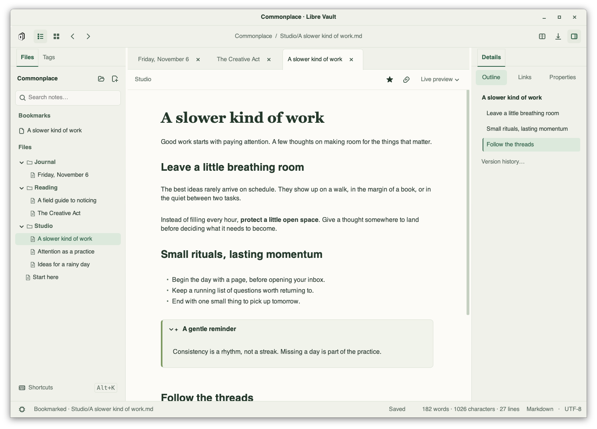
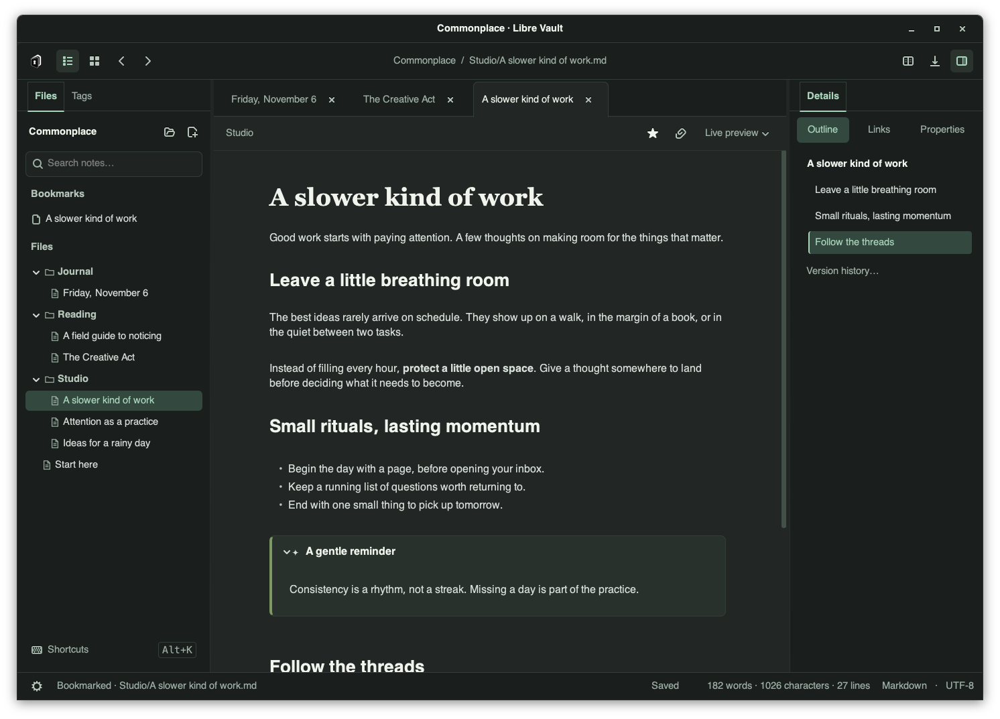
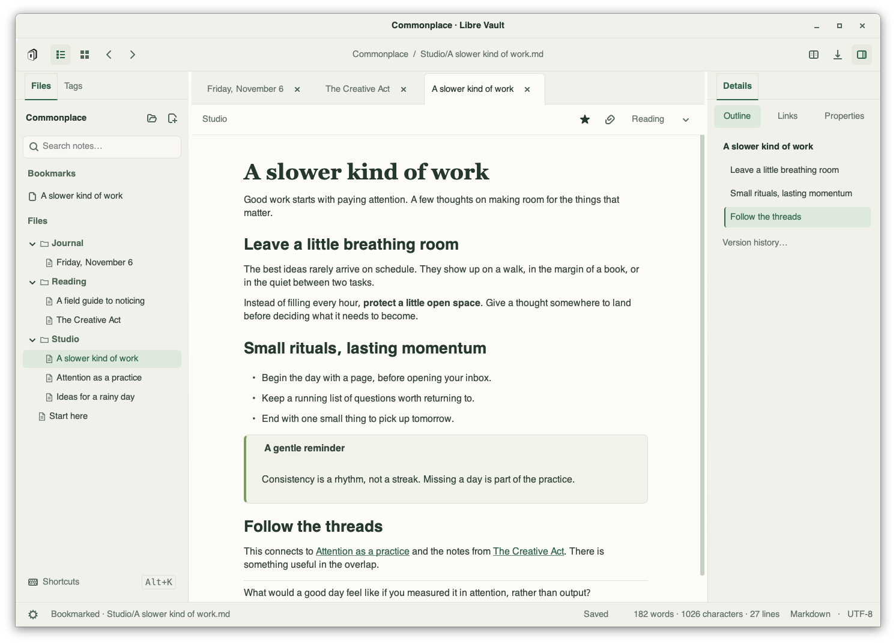
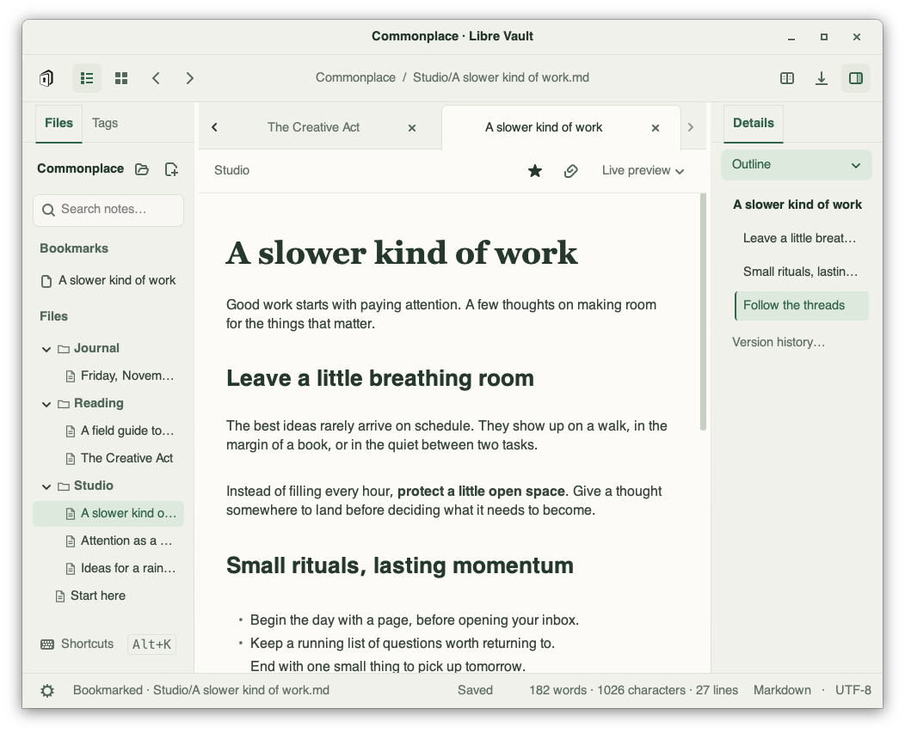
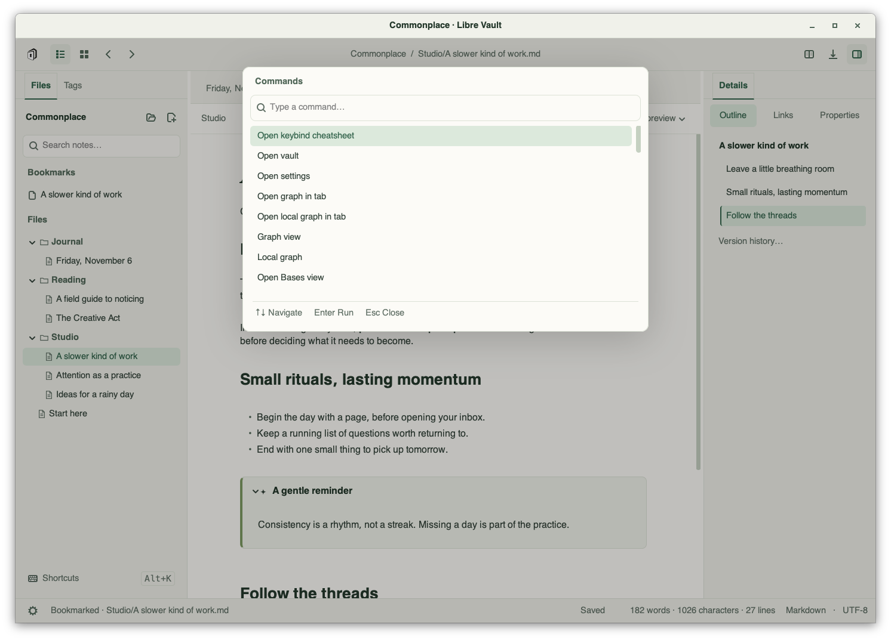
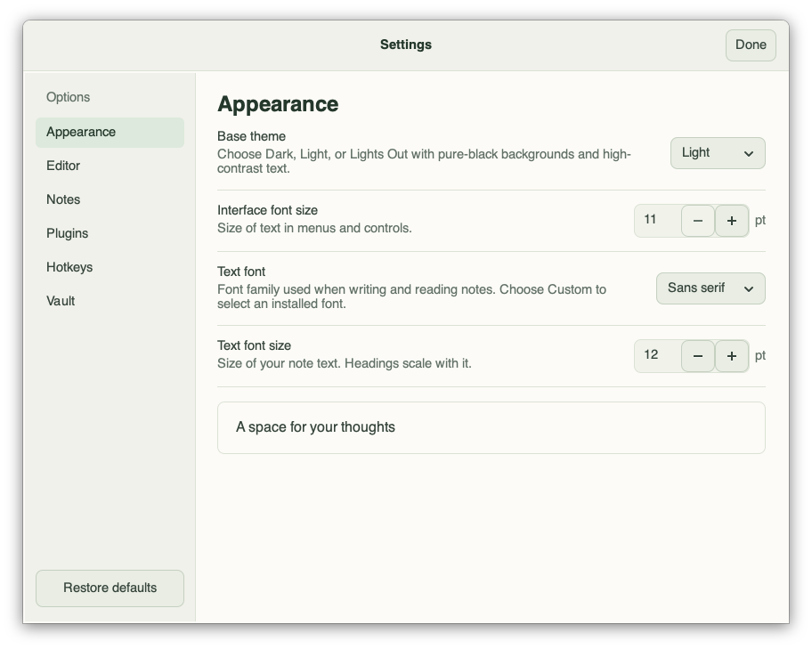
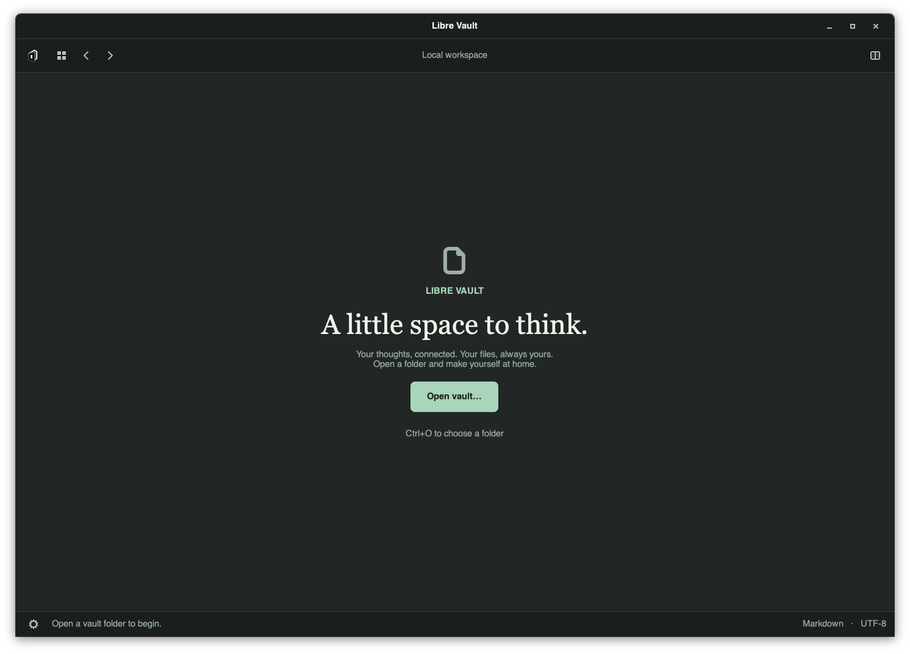
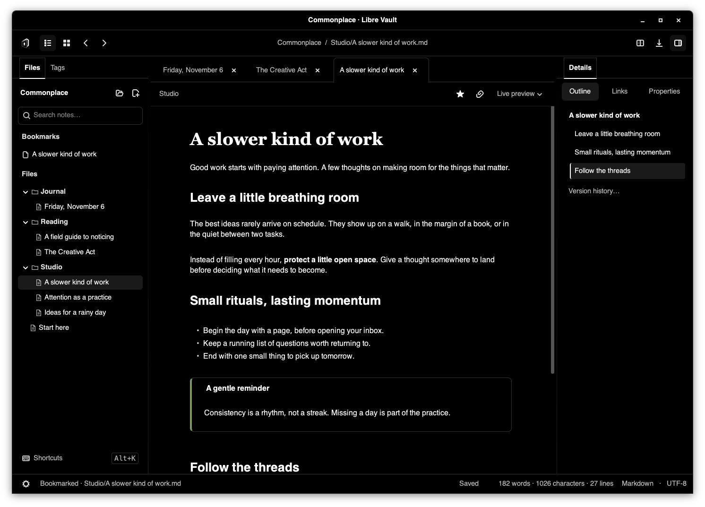

# UI Overhaul

Libre Vault uses a warm writing surface framed by sage navigation. The light and dark palettes are designed separately; Lights Out keeps its pure-black surfaces. A serif document title, smaller section headings, clear selected states, and quiet toolbars give notes a stronger hierarchy without changing their Markdown.

The overhaul also fixes the file tree sliding outside its panel when the window shrinks. Reading mode uses normal bullets and numbered lists, including nested lists and non-default starting numbers, instead of boxing every item.

## Screenshots

These are real GTK widget captures from a disposable vault, not mockups. The capture script opens the welcome screen, a note in all three themes, reading mode, commands, settings, and a compact window. Review images are generated into `artifacts/ui-overhaul`.

```sh
./check.sh --script scripts/capture_ui.py
```

The usual runner uses a background Hyprland workspace or a private Xvfb display. On a host with a Broadway-enabled GTK build, `./check.sh --broadway --script scripts/capture_ui.py` uses an isolated headless GTK daemon. It binds its HTTP interface to a private Unix socket, uses a loopback display connection, and stops the daemon after the probe. No browser or active desktop is used. Stock macOS Homebrew GTK does not include this backend; the review was captured with a temporary GTK 3.24.52 Broadway build.

New workspaces default to 12pt note text in a 680px writing column; stored preferences are preserved. Typography still respects the 11pt minimum and custom editor fonts. The default sans preset uses an editorial serif title in live preview. Body text and section headings retain the selected editor font.

## Validation

Full validation before the macOS shortcut follow-up ran 528 tests through the private Broadway display: 520 passed, one skipped for unavailable language fonts, and seven failed or errored. All seven also occur on the unchanged base: two filesystem-monitor checks, trusted-plugin opt-in cancel, the launcher interpreter/dependency check, the narrow table dialog, case-sensitive attachment resolution on this case-insensitive filesystem, and the custom-font chooser. Across earlier runs, a third filesystem-monitor failure and an intermittent GTK hit-testing abort also reproduced on the unchanged base. The hit-testing abort produced the same GTK byte-index error in one of five targeted runs on both the base and overhaul; it passed the final suite. The base additionally fails two compact-panel checks that this overhaul fixes.

A later follow-up fixes the intermittent hit-testing abort: the editor now uses GTK cursor geometry, which accounts for hidden text, to keep pointer coordinates out of paragraph padding. The previous character-rectangle lookup used raw buffer byte indices, and its empty-rectangle fallback included unsafe padding. A deterministic regression fails with the previous implementation and passes with the fix for Unicode aliases and wrapped text. All 57 targeted checks pass, including ten repetitions of both hit-testing probes, as does the GUI smoke test, through the private Broadway runner.

The earlier 36 focused live-preview, reading-renderer, and hit-testing checks also passed, as did the GUI smoke test. A regression verifies embedded callout notes survive repeated edits while preserving the document's preview budget. Native macOS and Linux X11 presentation still need platform validation; these captures validate actual GTK layout and painting on the headless Broadway backend.

## Council review

Rounds: 3. All three reviewers rated the same final eight captures at least 9/10, explicitly confirmed satisfaction, and reported no material blockers. The council reviewed the implementation and images at `1e7ec03`. The later macOS shortcut follow-up is described below.

| Delegate | Round 1 | Round 2 | Round 3 |
| --- | --- | --- | --- |
| GPT Sol | 8.2/10 | 9.0/10 | 9.1/10 |
| Gemini 4 Argon | 8.1/10 | 9.3/10 | 9.4/10 |
| Grok 4.7 | 7.5/10 | 8.6/10 | 9.1/10 |

Round 1 feedback led to the compact details selector, clearer typography and text measure, consistent callouts, more useful command results, and preservation of custom fonts and dock controls. In round 2, GPT and Gemini approved the visuals; Grok flagged the callout glyph and arrow alignment. The glyph is removed, title padding is balanced, and the open arrow appears only on hover. GPT also found a callout embed budget bug, which is fixed and passed its focused recheck at 9.0/10.

## macOS shortcut readability follow-up

Shortcut labels now spell out Command, Option, Control, and Shift on macOS instead of using small modifier glyphs. The cheatsheet, hotkey settings, and sidebar use the same formatter. Badges use the interface font with stronger text contrast and a subtle filled background. Long sidebar labels truncate with the full binding available in the tooltip and accessible name. Existing bindings are preserved, and shorthand searches such as `Ctrl+O` still work.

The follow-up passes 33 shortcut and panel tests through the isolated Broadway runner, including macOS modifier names in all three shortcut surfaces, other-platform formatting, search, and compact sidebar layout. An isolated GTK capture also verifies the rendered labels. The council gallery below records the screenshots reviewed before this follow-up.

## Tags panel follow-up

The Tags dock now uses the full available height with consistent outer padding, comfortable row spacing, aligned counts, and sidebar colors in all three themes. The old duplicate expander and 220px tree cap are removed. Long tags ellipsize with full-name tooltips; the rename action stays at the bottom and requires a selection. Empty vaults show “No tags yet.”

All 19 targeted property/tag, panel, and dock-restoration tests pass through the private Broadway runner. Captures verify populated and empty panels, all three themes, and compact layout.

## Gallery









