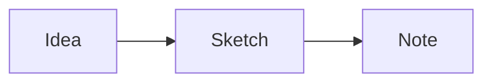

# Formatting playground

## Common Markdown

**Bold**, *italic*, `inline code`, and ~~strikethrough~~.

> A blockquote with **emphasis**.

1. First item
2. Second item
   - Nested bullet

---

## Extended syntax for future compatibility

These fixtures deliberately include syntax the current preview does not fully support.

| Object | Color | Count |
| --- | --- | ---: |
| Lantern | Amber | 3 |
| Notebook | Blue | 7 |

> [!tip] An invented tip
> Keep the imaginary map folded beside the paper compass.

A sentence with a footnote.[^one]

[^one]: A fictional footnote for rendering tests.

==Highlighted words== and %%an Obsidian comment%%.

$$
x^2 + y^2 = r^2
$$

